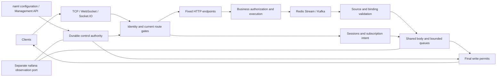

# Runtime architecture

[中文](architecture.md)

nacket centralizes business-selected ProtocolBytes encoding, dynamic routes, authorization and clustered delivery in a configuration-driven process. Business services integrate through REST/MQ contracts without extending the image. Socket.IO is an optional adapter; disabling it leaves native TCP/WebSocket, subscriptions and cluster delivery available.

## Components and responsibility

| Directory | Responsibility |
| --- | --- |
| bootstrap | napp assembly, configuration entry, lifecycle, readiness and registration eligibility |
| config | Deployment switches, budgets, fixed references and cross-validation |
| domain | Routes, authorization, sessions, messages and control invariants independent of network I/O |
| application | Handshake, actions, subscriptions, initialization, delivery, control coordination and listener ownership |
| adapters | Native/Socket.IO/management ingress and HTTP/Redis/Kafka/persistence adapters |
| observability | Bounded events, resource ownership, durations and authority/dependency snapshots |
| contracts | Exported configuration and communication structures, without another business codec |

The `#[nasa::application]` entry registers the plan. napp prepares, starts, supervises and closes resources. naml supplies strict YAML and refresh; nalog supplies logging; nafana supplies dedicated metrics and general resource collection. Framework components remain general, while route, permit and message contracts remain in this project.

## Definition changes and dynamic routes

Local mode protects one node's durable directory using atomic file replacement and a lock. Multi-node deployments explicitly select Redis or Kafka control; local mode is not cluster consistency.

The authority persists clusterId/scopeEpoch, stable nodeId, incarnation, route revision/definitionDigest, ownership, suspension, finite permits and operation progress. Nodes close old admission and wait for actual writes to drain before durably reporting Drained. They report Prepared after the new definition and listener are ready. A renewal must match the definition, node startup, incarnation and request nonce, with its lifetime still measured from the original request start. Only after opening the local gate and rechecking a write permit does the node durably report Applied. Request acceptance and a permit reply do not replace the final application fact. Incomplete preparation remains closed; one node's failure never restores its old authority.

Online/offline and schema/encoding/identity changes use the same control path. Shared listeners withdraw only the affected route. Dedicated listeners have one binding and shutdown owner. Automatic ports use actual bind without probe-and-reopen races. Reusing a port never revives a handshake tied to an old binding.

Redis ownership uses durable fencing with bounded clock/pause assumptions. Kafka ownership uses committed transactions, stable consumption and current assignment eligibility. Unknown commitment never creates permission. Expired evidence stops new protected actions; existing responsibility completes or closes within original deadlines, never restarting a lease from a late response.

Configuration and API ownership are separate. Emergency offline persists suspended; subsequent YAML cannot clear it. Conflicting content for the same sourceId/generation is rejected. Multiple nodes observing YAML does not authorize independent unconditional overwrites.

## Authorization and resources

Sessions reach Ready only after identity, optional connection authorization, confirmation and required initialization. sub is reading intent, not business membership. Subject, membership, group and exact-session revocation are separate. Cancellation/revocation withdraws permission before waiting for actual writes, then reports the corresponding completion.

Client msg is disabled by default. notify is limited to declared current-session actions, fixed HTTP or a dedicated business-signal channel. Trusted MQ downstream follows business REST permission checks and validates producer, tenant, route generation, schema, target and fixed expiry.

Shared Bytes retains business bodies. Pure forwarding parses fixed metadata without materializing business objects. TCP may write separate segments; WebSocket, Socket.IO, HTTP, broker clients and TLS can copy at their boundaries. Shared references do not imply end-to-end zero-copy. No-target delivery builds no final packet, and large fan-out yields between bounded batches.

Physical connections, unauthenticated peers, logical sessions, operations, ingress/egress bytes, HTTP, broker pending work, isolation and control output have separate budgets. Canceling a wait never releases responsibility still held by a real task. Slow consumers use only approved rejection, closure or keep_latest policies; ordinary events cannot silently become replaceable state.

Push and initialization replies require realtime consumption: Redis captures the tail when consumption begins, and Kafka uses a fresh group with latest on every start. Restarting does not replay offline backlog. The separate authorization-control ingress retains stable groups and explicit recovery baselines; control authority restores route and authorization floors. Missing security evidence preserves protection. See [realtime consumption boundaries](mq-delivery.en.md).

## Discovery, deployment and observation

Nacos configuration and discovery have separate switches. Remote authorization uses fixed service references; managed HTTP owns instance selection, deadlines and credentials. Browsers never hold registry details. One route going offline differs from node registration eligibility; deployment explicitly selects readiness policy.

Defaults are business port 3030 and health HTTP 3031. Monitoring uses another dedicated port, such as 9464, and separate credentials. Management actions require their own switch and real-peer allowlist. External TLS, Docker mappings and gateway addresses must be declared. The directory is neither an active reachability probe nor a grant of client authority.

naway can be an external TLS and HTTP/WebSocket proxy. nacket still owns identity, subscriptions, ProtocolBytes and control state, and does not require naway. When a proxy lacks dynamic-directory selection, use a fixed reachable ingress or let the business service resolve the directory; dynamic integration must not be assumed.

Monitoring aggregates bounded identity/labels for connections, queues, latency, authorization, consumption and control facts. Only a current owner with valid evidence exports the authority directory. Missing data differs from zero. Disk/network collection is limited to configured sources. Observation failures never change business permission. Shutdown closes admission and drains real responsibility; work surviving the original deadline is explicitly reported unfinished.

See [subject event ordering and capacity](uid-ordering.en.md) for state ordering, remote waits, control reservations and failure semantics. napp manages napart; product identity and authorization models remain outside the framework.
