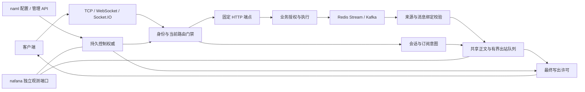

# 运行架构

[English](architecture.en.md)

nacket 将业务选择的 ProtocolBytes 编码、动态路由、权限和集群投递集中到一个配置驱动的进程。业务服务通过 REST/MQ 合同接入，不需要在镜像中编写插件。Socket.IO 是可关闭的接入适配器；关闭它不影响原生 TCP/WebSocket、订阅与集群分发。

## 组件与责任

| 目录 | 责任 |
| --- | --- |
| bootstrap | napp 装配、配置入口、组件生命周期、就绪与注册资格 |
| config | 部署开关、预算、固定资源引用与交叉校验 |
| domain | 路由、授权、会话、消息、控制状态和不依赖网络的安全不变量 |
| application | 握手、动作、订阅、初始化、投递、控制协调和监听责任 |
| adapters | 原生/Socket.IO/管理入口，HTTP、Redis、Kafka 与持久后端适配 |
| observability | 有界事件、资源责任、持续时间与权威/依赖快照 |
| contracts | 可导出的配置与通信结构，不含第二套业务编解码器 |

入口通过 `#[nasa::application]` 登记计划，napp 负责准备资源、启动、监督和关闭。naml 提供严格 YAML 与配置热更；nalog 提供日志；nafana 提供独立指标出口与通用资源采集。框架保持通用，产品路由、许可与消息合同位于本工程。

## 定义切换与动态上下线

本地模式用持久文件、原子替换与文件锁保护本节点目录。多节点必须显式选择 Redis 或 Kafka 控制后端；本地模式不能被当作集群一致性方案。

权威保存 clusterId/scopeEpoch、稳定 nodeId、节点 incarnation、路由 revision/definitionDigest、归属、暂停事实、有限许可和操作进度。节点先关闭旧定义的准入，等实际写出排空后持久上报 Drained；新定义与 listener 准备完成后上报 Prepared。
续权回复必须匹配定义、节点启动、实例代际和请求 nonce，并沿用原请求起点扣除往返耗时。
本地门禁成功开放并复验可取得写出许可后，才持久上报 Applied；请求受理或许可回复不能代替最终应用事实。
未完成时保持关闭或准备状态；某一节点准备失败不恢复其旧权限。

路由上线、下线、schema/编码/身份变化使用同一套控制路径。共享端口只关闭对应路由；独立端口由唯一 owner 绑定并回收。实际 bind 决定自动端口，无探测后重开的竞态。被撤销的 listener binding 不能因同端口再次使用而复活旧握手。

Redis owner 使用持久围栏和有界时钟/暂停条件；Kafka owner 使用已提交事务、稳定消费与当前分配资格。结果未知不会产生新权限。控制证据失效时数据面停止接纳新的受保护动作；已有责任按原始期限完成或关闭，不根据迟到响应重新计算寿命。

配置来源与 API 归属分开。紧急 offline 保留 suspended，后续 YAML 不自动解除；同 sourceId/generation 的冲突摘要拒绝。所有节点观察到同一 YAML 不代表可以各自无条件覆盖权威。

## 权限与资源边界

会话必须完成身份、可选连接授权、确认和必要初始化才能 Ready。sub 是读取意图，不能建立业务成员关系；用户、成员、群与精确会话撤销分别处理。取消和撤权先失效资格，再等待真实写出责任，之后才能报告相应完成。

客户端 msg 默认关闭。notify 只使用白名单中的当前会话动作、固定 HTTP 或专用业务通知通道，不能转成任意群发。业务下行来自 REST 校验后的受信 MQ；来源、租户、路由代次、schema、目标和固定期限全部核对。

正文以共享 Bytes 保留，纯转发只解析固定 metadata，不物化业务对象。TCP 可以分段写，WebSocket、Socket.IO、HTTP、MQ 客户端和 TLS 的边界可能需要复制，不能以局部共享引用宣称全链路零拷贝。无目标不组装最终下行包；大扇出按批次让出执行机会。

物理连接、未认证连接、真实来源、逻辑会话、操作、入站/出站字节、HTTP、MQ 待决、隔离和控制输出分别计费。取消等待不释放仍被真实任务持有的责任。慢接收方只能按路由批准的拒绝、关闭或 keep_latest 策略处理，不能让逐条事件隐式丢失。

业务推送和初始化回复只允许实时消费：Redis 在实际开始消费时取得当前末尾，Kafka 每次启动使用新组及 latest。重启不补读停机积压。专用授权控制入口保留稳定组和明确恢复基线，控制权威恢复路由与授权下界；缺失安全证据时保持保护。详见[实时消费边界](mq-delivery.md)。

## 发现、部署与观测

Nacos 配置中心与注册发现分别启停。远程鉴权选择固定服务引用；实例选择、调用截止时间和服务凭据由受管 HTTP 负责，浏览器不持有注册中心信息。单条路由下线与整个节点的注册资格不同，节点就绪策略由部署明确选择。

默认业务端口 3030，健康 HTTP 3031，监控使用独立端口（示例 9464）与凭据。管理动作另有开关及真实对端白名单。外部 TLS、Docker 映射与网关地址必须显式声明；地址目录不是主动探测结果，也不授予客户端权限。

naway 可作为外部入口承担 TLS 与 HTTP/WebSocket 代理。nacket 继续负责业务身份、订阅、ProtocolBytes 和控制状态。此服务不依赖 naway；当代理不支持动态接入目录时，部署应采用固定可达入口或由业务服务解析目录，不把动态选址能力假设为已集成。

监控以进程身份和有限标签聚合连接、队列、延迟、授权、消费和控制事实。权威目录只由当前 owner 在证据有效时输出，缺失与真实零分开。磁盘和网络只读取配置的有限来源；观测故障不改变业务权限。正常退出撤销接流后排空真实责任，原始截止点到达仍未结束的任务如实报告未完成。

主体状态事件的顺序、远程等待、控制预留和失败语义见[主体事件顺序与容量](uid-ordering.md)。napart 由 napp 托管，产品身份和权限模型不进入基础框架。
